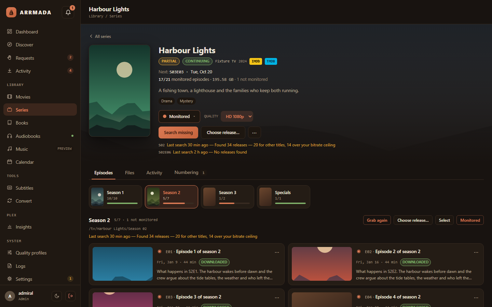
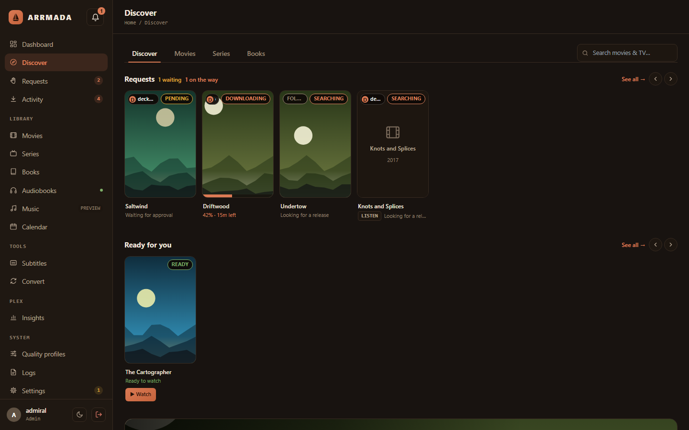
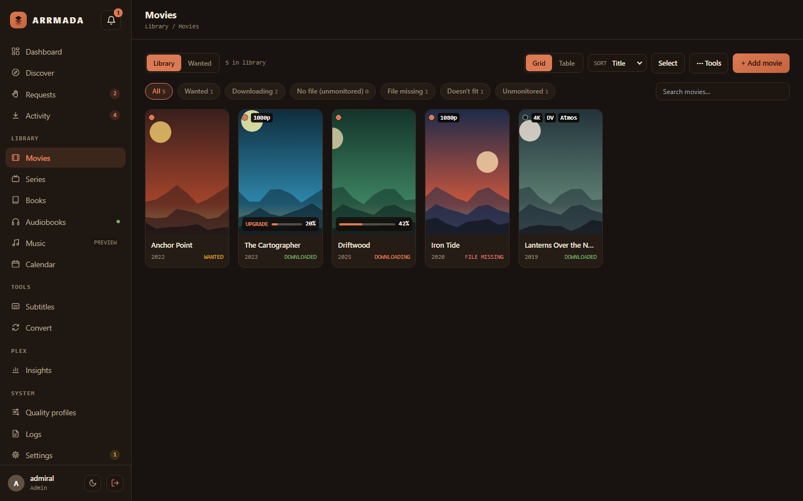
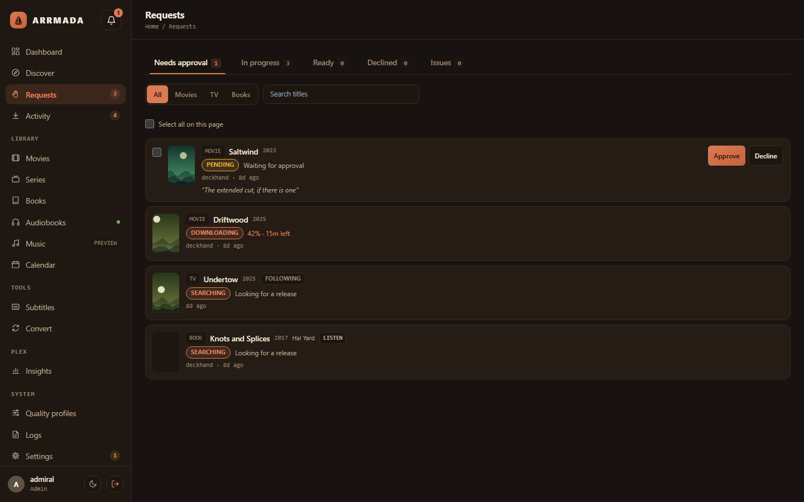
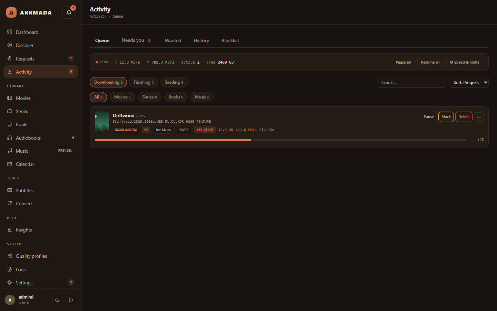
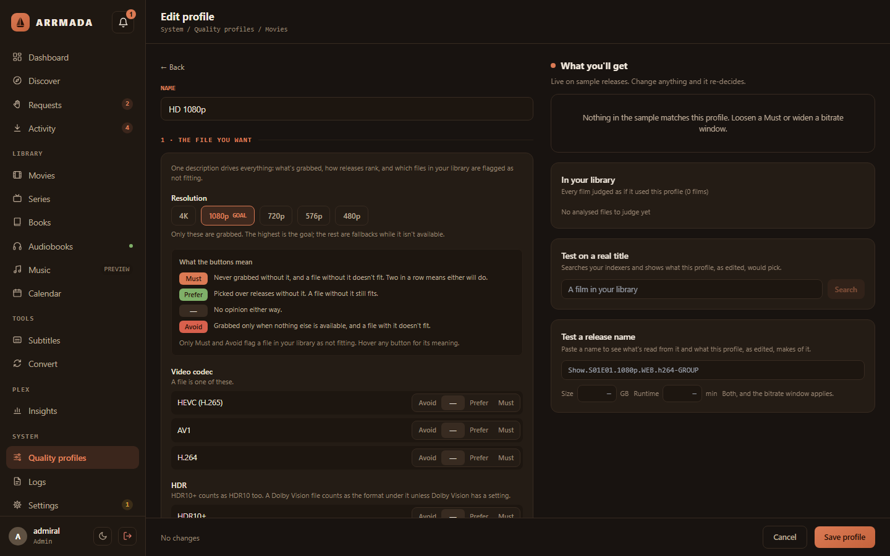
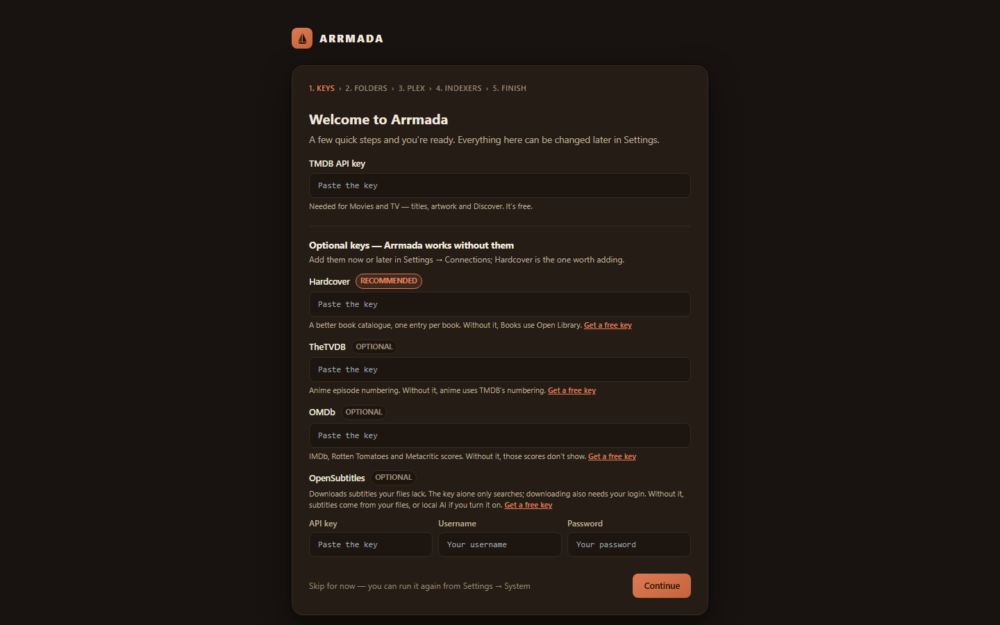
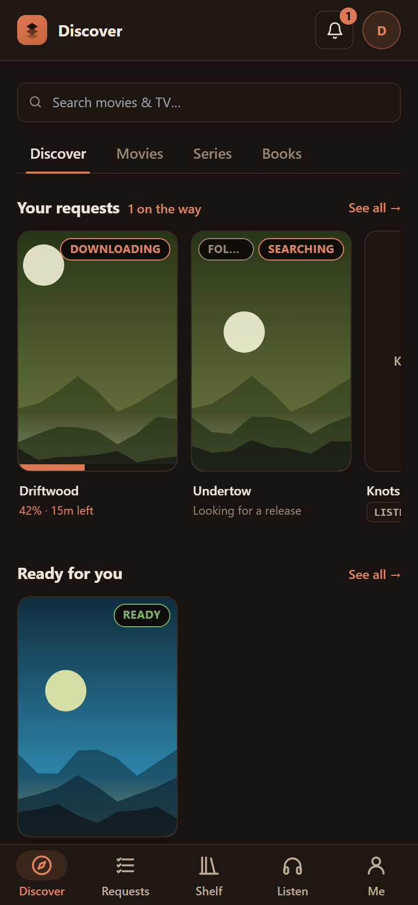
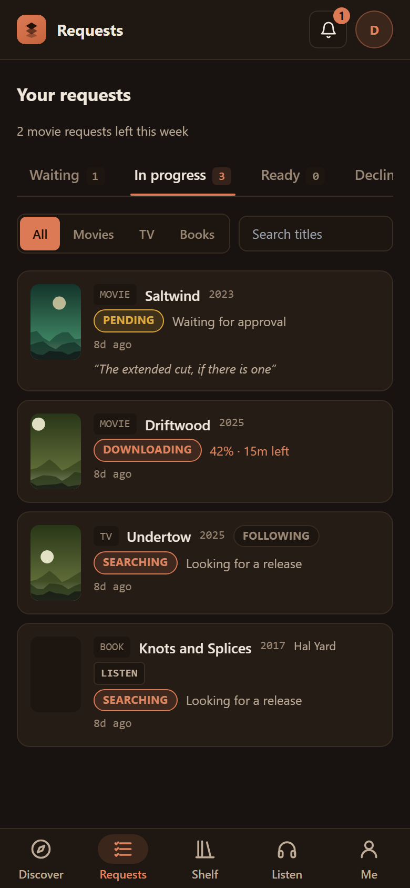

<div align="center">


# Arrmada

**Your whole media server in one app — movies, TV, books and requests, without the `*arr` stack.**

[Install](#install) · [Features](docs/features.md) · [Docs](#documentation) · [Issues](https://github.com/tristenlammi/Arrmada/issues)



</div>

Arrmada finds, downloads and organises your movies, TV, books and audiobooks, lets your
household request what they want to watch, and keeps your Plex or Jellyfin library tidy — with one
database and one web page instead of half a dozen apps. qBittorrent comes with it, already
set up.

> **Early days:** Arrmada is under active development (v0.x). Expect rough edges, and keep
> backups.

## What it does

- 🎬 **Movies and TV** — search, download, import, rename and upgrade, the way Radarr and Sonarr do. Anime numbering included. Moving over? Import your Radarr and Sonarr libraries, files and all.
- 📚 **Books and audiobooks** — ebooks and audiobooks with series tracking, plus a built-in audiobook server for listening apps like Lissen.
- 🙋 **Requests** — family and friends browse and request titles, Overseerr-style, and get told when they're ready. Sign in with Plex or Jellyfin.
- 💬 **Subtitles** — pulls them out of the file, downloads them, or writes them with local AI.
- 🗜️ **Convert** — shrinks wasteful video overnight to HEVC or AV1, checking every result against the original.
- 📺 **Plex and Jellyfin** — connect either or both: Watch buttons, library updates after every change, and Insights — who's watching what, history and stats, Tautulli-style.
- 📰 **Usenet, optional** — SABnzbd alongside qBittorrent (`--with-sabnzbd` sets one up for you); bring your own Usenet provider and indexers.
- 🛟 **Safety nets** — hardlinked imports, a recycle bin, nightly backups and one-step rollbacks.

[See everything it does →](docs/features.md)

## Install

You need a Linux server with Docker and Docker Compose (on Unraid: the **Docker Compose
Manager** plugin). On the server, run:

```sh
curl -fsSL https://raw.githubusercontent.com/tristenlammi/Arrmada/main/install.sh | sh
```

It asks where to keep Arrmada's files and where your media lives (press Enter to accept the
suggestions), then starts everything. Open the address it prints —
**`http://<your-server>:7878`** — create your admin account, and a short setup walks you
through the rest in the browser: your free TMDB key, your library folders, your media server (Plex, Jellyfin or both) and indexers.

[Install guide, options and Unraid notes →](docs/install.md)

### Prefer Docker Compose?

In an empty folder on the server:

```sh
curl -fsSL https://raw.githubusercontent.com/tristenlammi/Arrmada/main/docker-compose.example.yml -o docker-compose.yml
```

Next to it, a `.env` with your folders (full paths), and the other settings marked `←` in
the file if you want to change them (the user and group, your timezone, the port):

```sh
ARRMADA_DATA_HOST=/srv/arrmada/data     # Arrmada's database and settings
ARRMADA_STORAGE_HOST=/srv/media         # your libraries and downloads
```

Then run `docker compose up -d`, open **`http://<your-server>:7878`** and follow the setup.
The compose file itself stays as downloaded, so updating it never loses your settings.
To update: `docker compose pull && docker compose up -d`. That skips the installer's
pre-update backup and automatic roll-back; the app still copies its database before any
upgrade of it. [More →](docs/install.md#docker-compose-without-the-installer)

Using Portainer? The same file works as a stack, with the same lines as its environment
variables: [Using Portainer →](docs/install.md#using-portainer)

### On Unraid, from the Docker page

Arrmada's Unraid template is one container with qBittorrent and FlareSolverr built in and
already connected (switch either off to use your own), managed and updated from Unraid's
Docker tab like your other containers, with your media share at `/storage`.
[Arrmada on Unraid →](docs/unraid.md)

## Update

Run the same line again:

```sh
curl -fsSL https://raw.githubusercontent.com/tristenlammi/Arrmada/main/install.sh | sh
```

It backs up the database, updates, and checks Arrmada comes back — if the new version doesn't
start, it goes back to the one you had. (In Arrmada's folder, `sh update.sh` does the same.)

Installs follow the **stable** channel: updates bring the latest published release, never
unreleased code. Developers can follow **main** instead, the newest code compiled on the
server ([Following main](docs/updating.md#following-main-developers)).
[More about updating →](docs/updating.md)

## Screenshots

<table>
<tr>
<td></td>
<td></td>
</tr>
<tr>
<td></td>
<td></td>
</tr>
<tr>
<td></td>
<td></td>
</tr>
</table>

<p align="center">

&nbsp;&nbsp;

</p>

## Requirements

- A 64-bit Linux server — Unraid, Debian, Ubuntu and the like — on Intel/AMD (x86-64) or
  64-bit ARM (arm64: a Raspberry Pi 4/5 with a 64-bit OS, ARM NAS boxes). On ARM, Convert and
  AI subtitles run on the CPU ([what differs](docs/install.md#arm)).
- Docker with Compose v2.
- A free [TMDB API key](https://www.themoviedb.org/settings/api) (entered in the app).
- Optional: Intel or AMD graphics for faster Convert and AI subtitles, or an NVIDIA card for
  faster Convert (x86-64 only; [GPU setup](docs/gpu.md)), and a Plex or Jellyfin server.

## Documentation

| | |
|---|---|
| [Install](docs/install.md) | The one-liner, its options, Unraid, the git checkout way |
| [Unraid](docs/unraid.md) | The Unraid template: share layout, the built-in qBittorrent or your own, GPU, updates |
| [Updating](docs/updating.md) | Updates, rollbacks, published images |
| [Configuration](docs/configuration.md) | Ports, `.env`, media folders and hardlinks, recycle bin, reverse proxies |
| [GPU](docs/gpu.md) | Hardware encoding for Convert (Intel, AMD, NVIDIA) and GPU AI subtitles |
| [Backups](docs/backups.md) | Backups, restoring, a forgotten admin password |
| [Troubleshooting](docs/troubleshooting.md) | Common problems and fixes |
| [Features](docs/features.md) | Everything Arrmada does |
| [Alerts to n8n](docs/n8n.md) | Sending alerts to n8n or any webhook as signed JSON, and every event's fields |
| [Homepage dashboard](docs/homepage.md) | Arrmada's numbers on a gethomepage.dev dashboard: the widget key, the `services.yaml` entry and every field |
| [Development](docs/development.md) | Building and testing it yourself |
| [Releasing](docs/releasing.md) | For maintainers |

## Contributing

Bug reports and ideas are welcome in [Issues](https://github.com/tristenlammi/Arrmada/issues).
For code, see [Development](docs/development.md) — please open an issue before a big change.

## License

[MIT](LICENSE) © 2026 Tristen Lammi
