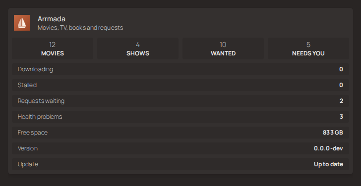

# Arrmada on a Homepage dashboard

[Homepage](https://gethomepage.dev) is a popular start page for a homelab. Arrmada has a
small read-only summary made for Homepage's `customapi` widget, so your dashboard can show
how many movies and shows you have, what's wanted, what's downloading, requests waiting,
what needs you, disk space and whether an update is out.



It shows **counts only** — never a title, a person's name, a folder or anything about what
anyone watches or listens to.

## Set it up

### 1. Make a widget key in Arrmada

As an admin, open **Settings → System → Dashboard widget** and press **Make widget key**.
The card shows a ready-to-paste `services.yaml` entry with your address and the new key
filled in, plus **Copy entry** and **Copy key only** buttons. If you opened Arrmada on an
outside address (your tunnel or reverse proxy), the entry has `http://ARRMADA-LAN-ADDRESS:PORT`
in its place — replace it with the LAN address (see [Which address](#which-address)).

The key is shown **once**. Arrmada keeps only a fingerprint of it, so it can't be read back
later — not from the app, the database, a backup or a support bundle. If you lose it, press
**Make a new key** (the old one stops working straight away) and update Homepage.
**Turn off** stops the widget altogether.

### 2. Give the key to Homepage

You can paste the key straight into `services.yaml`, but it's tidier to keep it out of the
file with one of Homepage's variables. In Homepage's Compose file (or `docker run -e`):

```yaml
services:
  homepage:
    image: ghcr.io/gethomepage/homepage:latest
    environment:
      HOMEPAGE_VAR_ARRMADA_WIDGET_KEY: arrw_…   # the key from step 1
```

Homepage replaces `{{HOMEPAGE_VAR_ARRMADA_WIDGET_KEY}}` anywhere in its config with that
value. Once the key has been made, the Settings card shows the entry with this variable in
place of the key.

### 3. Add Arrmada to `services.yaml`

Change `http://192.168.1.10:7878` to the address **Homepage's server** uses to reach
Arrmada (see [Which address](#which-address)):

```yaml
- Media:
    - Arrmada:
        icon: https://raw.githubusercontent.com/tristenlammi/Arrmada/main/web/public/icon-192.png
        href: http://192.168.1.10:7878
        description: Movies, TV, books and requests
        widgets:
          - type: customapi
            url: http://192.168.1.10:7878/api/v1/widget/homepage
            refreshInterval: 30000
            headers:
              X-Api-Key: {{HOMEPAGE_VAR_ARRMADA_WIDGET_KEY}}
            mappings:
              - field: movies
                label: Movies
                format: number
              - field: shows
                label: Shows
                format: number
              - field: wanted.total
                label: Wanted
                format: number
              - field: needs_you
                label: Needs you
                format: number
          - type: customapi
            url: http://192.168.1.10:7878/api/v1/widget/homepage
            refreshInterval: 60000
            headers:
              X-Api-Key: {{HOMEPAGE_VAR_ARRMADA_WIDGET_KEY}}
            display: list
            mappings:
              - field: queue.downloading
                label: Downloading
                format: number
              - field: queue.stalled
                label: Stalled
                format: number
              - field: requests_pending
                label: Requests waiting
                format: number
              - field: health.problems
                label: Health problems
                format: number
              - field: disk.lowest_free_bytes
                label: Free space
                format: bytes
              - field: version
                label: Version
              - field: update_available
                label: Update
                remap:
                  - value: true
                    to: Available
                  - any: true
                    to: Up to date
```

That's one card with two widgets: four headline numbers as blocks (Homepage shows at most
four blocks per widget), then a short list for the rest. Keep either one, swap fields for
any in [the table below](#every-field), or move the list into a service of its own. If you
already have a `Media` group, leave out the first line and indent the rest under it.

Homepage picks up `services.yaml` changes without a restart; a new environment variable
needs the container restarted.

Tested with Homepage v2.6.0.

### The icon

Arrmada isn't in Homepage's built-in icon sets yet, so the entry uses Arrmada's own icon
from GitHub. If your dashboard can't reach GitHub, point `icon:` at your Arrmada instead:
`http://192.168.1.10:7878/icon-192.png`.

## Which address

Homepage fetches the widget from **its own server**, not from your browser, and Arrmada only
answers the widget on your home network. So the `url:` must be an address that Homepage's
container can reach Arrmada on directly:

- **Both on the same Docker network** (the same Compose project, or a shared network): use
  the container name, e.g. `http://arrmada:7878`.
- **Otherwise:** the Arrmada host's LAN address, e.g. `http://192.168.1.10:7878`.

Don't use your outside (tunnel or reverse-proxy) address for `url:` — a request that arrives
from outside your network is refused, the same as for every other part of Arrmada that isn't
meant for the internet. The `href:` (where clicking the card takes you) can be whatever
address you open Arrmada on.

## Every field

`GET /api/v1/widget/homepage` answers with JSON like this:

```json
{
  "movies": 412, "shows": 38, "episodes": 2210, "books": 96,
  "wanted": { "movies": 3, "episodes": 14, "books": 2, "total": 19 },
  "queue": { "ok": true, "total": 9, "downloading": 2, "seeding": 6, "stalled": 1,
             "paused": 0, "errored": 0, "down_speed": 5242880, "up_speed": 131072 },
  "requests_pending": 2,
  "needs_you": 5,
  "health": { "status": "warning", "problems": 1, "errors": 0, "warnings": 1 },
  "disk": { "ok": true, "free_bytes": 2199023255552, "total_bytes": 8796093022208,
            "lowest_free_bytes": 429496729600, "lowest_free_pct": 12.5 },
  "version": "v0.2.0", "update_available": true, "latest_version": "v0.3.0"
}
```

Use dots for nested fields (`queue.downloading`).

| Field | What it is | Format |
| --- | --- | --- |
| `movies`, `shows`, `episodes`, `books` | How many are in the library. | `number` |
| `wanted.movies`, `wanted.episodes`, `wanted.books` | Monitored and still without a file — what Arrmada is searching for. Episodes count only aired ones of shows that aren't paused. | `number` |
| `wanted.total` | The three added up. | `number` |
| `queue.downloading` | Downloads moving right now. | `number` |
| `queue.seeding` | Finished torrents still seeding. | `number` |
| `queue.stalled` | Unfinished downloads nobody is sending. | `number` |
| `queue.paused`, `queue.errored` | Paused, and stopped by an error. | `number` |
| `queue.total` | Everything in the download client(s). | `number` |
| `queue.down_speed`, `queue.up_speed` | Bytes per second, all downloads together. | `bytes` with `suffix: /s` |
| `queue.ok` | `false` when the download client couldn't be read; the queue counts are then 0. | `text` |
| `requests_pending` | Requests waiting for approval. | `number` |
| `needs_you` | Everything on **Activity → Needs you** (requests waiting included). | `number` |
| `health.status` | `ok`, `warning` or `error` — the worst health finding (Settings → Status). | `text`, with `remap` |
| `health.problems`, `health.errors`, `health.warnings` | How many health findings, and of which kind. | `number` |
| `disk.free_bytes`, `disk.total_bytes` | Free and total space over the library and download disks, each disk counted once. | `bytes` |
| `disk.ok` | `false` when no disk could be read yet; the disk numbers are then 0. A disk that stops answering (a dead network share) leaves its last reading in place. | `text` |
| `disk.lowest_free_bytes`, `disk.lowest_free_pct` | Free space on the fullest of those disks — the one to watch. | `bytes` / `percent` |
| `version` | The running version. | `text` |
| `update_available` | `true` when Settings → Status says an update is out; always `false` while that check is off. | `text`, with `remap` |
| `latest_version` | The newest release the update check knows of (empty while it's off). | `text` |

The answer is worked out at most every 15 seconds and shared by every dashboard asking, so
it can be up to 15 seconds old. `requests_pending`, `needs_you` and the health counts are as
of Arrmada's last check, usually less than a minute old.

## Security

- **One key, one job.** The widget key opens this one read-only route and nothing else. It
  isn't an account and can't sign in, call any other part of the API or change anything.
  Nobody's session or account works on the widget either, so the key is the only way in.
- **Only admins** can make, replace or turn off the key.
- **Counts only.** No titles, names, folders or listening activity are ever in the answer —
  so the key can't tell anyone what's in your library or who watches what.
- **Sent as a header** (`X-Api-Key`, or `Authorization: Bearer`), never in the address, so it
  stays out of logs. A key in the address is refused.
- **Home network only.** An address that sends 30 wrong keys in a minute is told to wait;
  the right key is never limited, so another device getting it wrong can't lock Homepage out.
- Treat the key like a password anyway: anyone who has it, on your network, can see the
  counts. If it leaks, make a new one.
